<!-- i18n-source: README.md aac1b652e13b90929d527cd6942e248b8ff20034 -->

<h1 align="center">assay</h1>

<p align="center"><a href="README.md">English</a> · <a href="README.zh-CN.md">简体中文</a> · <b>日本語</b> · <a href="README.ko.md">한국어</a> · <a href="README.ru.md">Русский</a></p>

<p align="center">
  <a href="https://github.com/awss1i/assay/blob/main/pyproject.toml"></a>
  <a href="https://github.com/awss1i/assay/blob/main/LICENSE"></a>
  <a href="https://github.com/sickn33/agentic-awesome-skills"></a>
  <a href="https://github.com/TheJambo/awesome-testing"></a>
  <a href="https://github.com/awesome-opencode/awesome-opencode"></a>
</p>

<p align="center">
  <a href="#install">インストール</a> · <a href="#getting-started">はじめに</a> · <a href="#benchmarks">ベンチマーク</a> · <a href="#docs">ドキュメント</a> · <a href="#contributing">コントリビューション</a> · <a href="#licence">ライセンス</a>
</p>

---

<p align="center"><strong>エージェントネイティブな Web ページ向け QA CLI。決定論的、テスト不要、LLM 不要。</strong></p>

<p align="center">
  
</p>

<p align="center"><i>バグを含む、ドラッグで並べ替えるリストをチェックした例。</i></p>

---

assay はページを Chromium で開き、ページ上のコントロールをすべて見つけ出して、そのすべてを実際に操作し、うまくいかなかった点を報告します。

- **テストを書く必要はありません。** assay は、ページ上で見つけたコントロールをもとにチェックを組み立てるので、テストスクリプトも基準となるスクリーンショットも管理する必要がありません。
- **LLM は使いません。** API キーも費用も不要で、何度実行しても同じ結果になり、1 ページのチェックにかかる時間の中央値は 14 秒です。
- **コーディングエージェントと連携します。** 15 種類の harness（エージェントの実行環境）に対応した skill を使うと、エージェントは自分が書いたページを 1 つずつチェックします。Claude Code、Codex、Grok Build CLI、Devin CLI、Factory Droid、GitHub Copilot CLI、DeepSeek Harness では、さらにフックがターンの終わりに毎回チェックを自動で実行します。
- **重複をまとめます。** 1 つのバグが複数のチェックを失敗させた場合、2 件目以降は同じメッセージを繰り返さず、*same finding as C003*（C003 と同じ指摘）と表示します。

assay はページが何のためのものかを知らないので、ページが自己矛盾している（the page contradicts itself）箇所を報告します。たとえば、リストが空なのに件数が 1 と表示される場合や、「Undo」が 1 回目には何もせず 2 回目で動く場合です。動作はするものの間違ったことをするページ、たとえば合計の計算が間違っているページは、たいていチェックを通過します。

---

## <a id="install"></a>インストール

```bash
pip install assay-ui
```

assay は uv や pipx でもインストールでき、skill とプラグインは 15 種類のコーディングエージェント向け harness にインストールできます。

[すべてのインストール方法](https://github.com/awss1i/assay/blob/main/docs/install.ja.md)

---

## <a id="getting-started"></a>はじめに

ページが入っているフォルダーを assay に指定します。

```console
assay ./my-app                    # このフォルダーの index.html をチェック
assay ./my-app --report out.html  # スクリーンショット付きの HTML レポートも書き出す
assay ./my-app --one-line         # スクリプトやエージェント向けの短い要約
```

失敗が 1 つでもあれば終了コードは 0 以外になります。初回の実行時に Chromium をダウンロードすることを除けば、指定しない限りディスクには何も書き込みません。

コーディングエージェントでは、プラグインがページに変更があったターンの終わりに毎回チェックを実行し、エージェントが assay の見つけた内容を報告します。Claude Code では、次の 2 つのコマンドでインストールします。

```
/plugin marketplace add awss1i/assay
/plugin install assay@assay
```

[はじめに](https://github.com/awss1i/assay/blob/main/docs/getting-started.ja.md)

---

## <a id="benchmarks"></a>ベンチマーク

assay はこのリポジトリにある 2 組のページで評価しています。以下の表は採点スクリプトが書き込んだものです。

| セット | ページ数 | 見つけたバグ | 問題ありと判定した正常なページ |
|---|---|---|---|
| [AI が書いたページ](https://github.com/awss1i/assay/blob/main/benchmarks/generated.md) | 225 | 20 個中 15 個 | 205 ページ中 0 ページ |
| [意図的にバグを仕込んだページ](https://github.com/awss1i/assay/blob/main/benchmarks/planted.md) | 20 | 50 個中 12 個 | 10 ページ中 0 ページ |

AI が書いたページでは、1 ページのチェックにかかった時間の中央値は 14 秒で、225 ページのうち 221 ページが 1 分以内に終わりました。

AI が書いたページは、プロンプトの一覧から AI が書いた小さな Web アプリで、その後、人が実際に開いて試しました。意図的にバグを仕込んだページは、正常に動くアプリとその複製からなり、assay の存在を知らされていない別のエージェントが、それぞれの複製に自分で選んだバグを仕込みました。assay のルールはバグを仕込んだページを見ながら開発したため、このスコアは開発に使ったページそのものでの評価（in-sample）です。

[すべてのベンチマーク](https://github.com/awss1i/assay/blob/main/benchmarks/README.md)

---

## <a id="docs"></a>ドキュメント

| ドキュメント | 内容 |
|---|---|
| [使い方](https://github.com/awss1i/assay/blob/main/docs/usage.ja.md) | すべてのオプション、assay の出力、終了コード、HTML レポート、Python API |
| [仕組み](https://github.com/awss1i/assay/blob/main/docs/how-it-works.ja.md) | 1 回の実行の流れ、すべてのチェックとそれぞれが出力する正確なメッセージ、assay がチェックできないこと |
| [Harness](https://github.com/awss1i/assay/blob/main/docs/harnesses.ja.md) | 対応している 15 種類のコーディングエージェント向け harness それぞれのインストール手順 |
| [skill とプラグイン](https://github.com/awss1i/assay/blob/main/plugins/assay/README.ja.md) | skill がエージェントに指示する内容と、プラグインのフックが各ターンの後に行うこと |
| [開発](https://github.com/awss1i/assay/blob/main/docs/development.ja.md) | コードの構成、ルールの変更、テスト、harness の追加 |

---

## <a id="contributing"></a>コントリビューション

バグやドキュメントの問題は Issue で報告し、質問やアイデアは Discussions へ、修正や新機能はプルリクエストで送ってください。タイトルは、変更が関係する領域の名前で始めます。たとえば `cli: what changed` のようにします。

[コントリビューション](https://github.com/awss1i/assay/blob/main/CONTRIBUTING.md)

---

## <a id="licence"></a>ライセンス

MIT ライセンスです。

---

このページは [README.md](README.md) の翻訳です。英語の原文と内容が異なる場合は、原文が優先されます。翻訳の誤りに気づいたら、プルリクエストで修正を送ってください。
