<!-- i18n-source: README.md aac1b652e13b90929d527cd6942e248b8ff20034 -->

<h1 align="center">assay</h1>

<p align="center"><a href="README.md">English</a> · <a href="README.zh-CN.md">简体中文</a> · <a href="README.ja.md">日本語</a> · <b>한국어</b> · <a href="README.ru.md">Русский</a></p>

<p align="center">
  <a href="https://github.com/awss1i/assay/blob/main/pyproject.toml"></a>
  <a href="https://github.com/awss1i/assay/blob/main/LICENSE"></a>
  <a href="https://github.com/sickn33/agentic-awesome-skills"></a>
  <a href="https://github.com/TheJambo/awesome-testing"></a>
  <a href="https://github.com/awesome-opencode/awesome-opencode"></a>
</p>

<p align="center">
  <a href="#install">설치</a> · <a href="#getting-started">시작하기</a> · <a href="#benchmarks">벤치마크</a> · <a href="#docs">문서</a> · <a href="#contributing">기여하기</a> · <a href="#licence">라이선스</a>
</p>

---

<p align="center"><strong>에이전트 네이티브 웹 페이지 QA CLI. 결정론적이며 테스트 작성도, LLM도 필요 없습니다.</strong></p>

<p align="center">
  
</p>

<p align="center"><i>버그가 들어 있는, 드래그로 순서를 바꾸는 목록을 검사하는 모습.</i></p>

---

assay는 Chromium에서 페이지를 열고, 페이지의 모든 컨트롤(control)을 찾아 전부 사용해 본 뒤, 무엇이 잘못되었는지 보고합니다.

- **테스트를 작성할 필요가 없습니다.** assay는 페이지에서 찾은 컨트롤로 검사(check)를 만들므로, 관리해야 할 테스트 스크립트나 기준 스크린샷이 없습니다.
- **LLM을 쓰지 않습니다.** API 키도 비용도 필요 없고, 몇 번을 실행해도 결과가 같으며, 페이지 하나를 검사하는 데 걸리는 시간의 중앙값은 14초입니다.
- **코딩 에이전트(coding agent)와 함께 동작합니다.** harness(에이전트 실행 환경) 15개에서 지원하는 skill은 에이전트가 작성한 페이지를 하나하나 검사하게 합니다. Claude Code, Codex, Grok Build CLI, Devin CLI, Factory Droid, GitHub Copilot CLI, DeepSeek Harness에서는 훅(hook)도 매 턴(turn)이 끝날 때마다 검사를 자동으로 실행합니다.
- **반복되는 실패를 묶습니다.** 버그 하나 때문에 여러 검사가 실패하면, 뒤에 실패한 검사는 같은 메시지를 반복하는 대신 *same finding as C003*(C003과 같은 발견 사항)이라고 표시합니다.

assay는 페이지의 용도를 모르기 때문에, 페이지가 스스로 모순되는(the page contradicts itself) 곳을 보고합니다. 예를 들어 목록이 비어 있는데 개수가 1로 표시되거나, Undo가 처음 누를 때는 아무 일도 하지 않고 두 번째에야 동작하는 경우입니다. 실행은 되지만 잘못 동작하는 페이지, 예를 들어 합계를 잘못 계산하는 페이지는 대개 통과합니다.

---

## <a id="install"></a>설치

```bash
pip install assay-ui
```

assay는 uv와 pipx로도 설치할 수 있고, skill과 플러그인(plugin)은 코딩 에이전트 harness 15개에 설치할 수 있습니다.

[모든 설치 방법](https://github.com/awss1i/assay/blob/main/docs/install.ko.md)

---

## <a id="getting-started"></a>시작하기

페이지가 들어 있는 폴더를 assay에 지정하세요.

```console
assay ./my-app                    # 이 폴더의 index.html 검사
assay ./my-app --report out.html  # 스크린샷이 포함된 HTML 보고서도 작성
assay ./my-app --one-line         # 스크립트와 에이전트용 짧은 요약
```

하나라도 실패하면 종료 코드가 0이 아닌 값이 됩니다. 첫 실행 때 Chromium을 내려받는 것을 제외하면, 요청하지 않는 한 디스크에 아무것도 쓰지 않습니다.

코딩 에이전트에서는 플러그인이 페이지를 변경한 턴이 끝날 때마다 검사를 실행하고, 에이전트가 assay가 찾은 내용을 보고합니다. Claude Code에서는 다음 두 명령으로 설치합니다.

```
/plugin marketplace add awss1i/assay
/plugin install assay@assay
```

[시작하기](https://github.com/awss1i/assay/blob/main/docs/getting-started.ko.md)

---

## <a id="benchmarks"></a>벤치마크

assay의 점수는 이 저장소에 있는 두 가지 페이지 세트로 매깁니다. 아래 표는 채점 스크립트가 기록합니다.

| 세트 | 페이지 수 | 찾은 버그 | 문제로 표시한 정상 페이지 |
|---|---|---|---|
| [AI가 작성한 페이지](https://github.com/awss1i/assay/blob/main/benchmarks/generated.md) | 225 | 20개 중 15개 | 205개 중 0개 |
| [의도적으로 심은 버그가 있는 페이지](https://github.com/awss1i/assay/blob/main/benchmarks/planted.md) | 20 | 50개 중 12개 | 10개 중 0개 |

AI가 작성한 페이지에서 페이지 하나를 검사하는 데 걸린 시간의 중앙값은 14초였고, 225개 중 221개가 1분 안에 끝났습니다.

AI가 작성한 페이지는 AI가 프롬프트 목록으로 작성한 작은 웹 앱이며, 사람이 하나하나 열어서 직접 사용해 봤습니다. 의도적으로 심은 버그(planted bug)가 있는 페이지는 정상 동작하는 앱과 그 복사본으로 이루어져 있고, assay의 존재를 전혀 알지 못하는 별도의 에이전트가 각 복사본에 스스로 고른 버그를 심었습니다. assay의 규칙(rule)은 버그를 심은 페이지들을 보면서 개발했으므로, 이 점수는 개발에 쓴 데이터로 매긴 표본 내(in-sample) 점수입니다.

[모든 벤치마크](https://github.com/awss1i/assay/blob/main/benchmarks/README.md)

---

## <a id="docs"></a>문서

| 문서 | 다루는 내용 |
|---|---|
| [사용법](https://github.com/awss1i/assay/blob/main/docs/usage.ko.md) | 모든 옵션, assay가 출력하는 내용, 종료 코드, HTML 보고서(report), Python API |
| [동작 방식](https://github.com/awss1i/assay/blob/main/docs/how-it-works.ko.md) | 실행 과정, 모든 검사와 각 검사가 출력하는 정확한 메시지, assay가 검사할 수 없는 것 |
| [Harness](https://github.com/awss1i/assay/blob/main/docs/harnesses.ko.md) | 지원하는 코딩 에이전트 harness 15개 각각의 설치 방법 |
| [skill과 플러그인](https://github.com/awss1i/assay/blob/main/plugins/assay/README.ko.md) | skill이 에이전트에게 지시하는 내용과 플러그인의 훅이 매 턴 뒤에 하는 일 |
| [개발](https://github.com/awss1i/assay/blob/main/docs/development.ko.md) | 코드 구성, 규칙 변경, 테스트, harness 추가 |

---

## <a id="contributing"></a>기여하기

버그와 문서의 문제는 이슈로 알려 주시고, 질문과 아이디어는 Discussions에서 나눠 주시고, 수정과 기능은 풀 리퀘스트로 보내 주세요. 제목은 변경이 다루는 영역 이름으로 시작합니다. 예를 들면 `cli: what changed`입니다.

[기여하기](https://github.com/awss1i/assay/blob/main/CONTRIBUTING.md)

---

## <a id="licence"></a>라이선스

MIT.

---

이 문서는 [README.md](README.md)의 번역본입니다. 영어 원문과 내용이 다르면 원문이 우선합니다. 번역 오류를 발견하면 풀 리퀘스트로 수정해 주세요.
