<h1 align="center">assay</h1>

<p align="center"><b>English</b> · <a href="https://github.com/awss1i/assay/blob/main/README.zh-CN.md">简体中文</a> · <a href="https://github.com/awss1i/assay/blob/main/README.ja.md">日本語</a> · <a href="https://github.com/awss1i/assay/blob/main/README.ko.md">한국어</a> · <a href="https://github.com/awss1i/assay/blob/main/README.ru.md">Русский</a></p>

<p align="center">
  <a href="https://github.com/awss1i/assay/blob/main/pyproject.toml"></a>
  <a href="https://github.com/awss1i/assay/blob/main/LICENSE"></a>
  <a href="https://github.com/sickn33/agentic-awesome-skills"></a>
  <a href="https://github.com/TheJambo/awesome-testing"></a>
  <a href="https://github.com/awesome-opencode/awesome-opencode"></a>
</p>

<p align="center">
  <a href="#user-content-install">Install</a> · <a href="#user-content-getting-started">Getting started</a> · <a href="#user-content-benchmarks">Benchmarks</a> · <a href="#user-content-docs">Docs</a> · <a href="#user-content-contributing">Contributing</a> · <a href="#user-content-licence">Licence</a>
</p>

---

<p align="center"><strong>An agent-native QA CLI for web pages. Deterministic, no tests to write, no LLM.</strong></p>

<p align="center">
  
</p>

<p align="center"><i>Checking a drag-to-reorder list with a bug in it.</i></p>

---

assay opens your page in Chromium, finds every control on it, uses all of
them, and reports what went wrong.

- **No tests to write.** assay builds its checks from the controls it finds
  on the page, so there are no test scripts or reference screenshots to keep.
- **No LLM.** There's no API key and no cost, every run gives the same
  result, and the median page takes <!-- median -->14 seconds<!-- /median --> to check.
- **Works with coding agents.** A skill, supported across fifteen harnesses,
  has the agent check each page it writes. In Claude Code, Codex, Grok Build
  CLI, Devin CLI, Factory Droid, GitHub Copilot CLI and the DeepSeek Harness,
  a hook also runs the check automatically after every turn.
- **Groups repeats.** When one bug fails several checks, the later ones say
  *same finding as C003* instead of repeating the message.

assay doesn't know what your page is for, so it reports the places where the
page contradicts itself, such as a count that shows 1 when the list is empty,
or an Undo that does nothing on the first press and works on the second. A
page that runs but does the wrong thing, like a total that adds wrongly,
usually passes.

---

## Install

```bash
pip install assay-ui
```

assay also installs with uv and pipx, and its skill and plugin install in
fifteen coding agent harnesses.

[All install options](https://github.com/awss1i/assay/blob/main/docs/install.md)

---

## Getting started

Point assay at the folder that holds your page.

```console
assay ./my-app                    # check index.html in this folder
assay ./my-app --report out.html  # also write an HTML report with screenshots
assay ./my-app --one-line         # short summary, for scripts and agents
```

The exit code is non-zero if anything failed. Apart from the Chromium download
on the first run, nothing is written to disk unless you ask.

In a coding agent, the plugin runs the check at the end of each turn that
changed a page, and the agent reports what assay found. In Claude Code, these
two commands install it.

```
/plugin marketplace add awss1i/assay
/plugin install assay@assay
```

[Getting started](https://github.com/awss1i/assay/blob/main/docs/getting-started.md)

---

## Benchmarks

assay is scored on two sets of pages in this repository, and the scoring
scripts write the table below.

<!-- results -->

| Set | Pages | Bugs found | Working pages flagged |
|---|---|---|---|
| [Pages written by AI](https://github.com/awss1i/assay/blob/main/benchmarks/generated.md) | 225 | 15 of 20 | 0 of 205 |
| [Pages with planted bugs](https://github.com/awss1i/assay/blob/main/benchmarks/planted.md) | 20 | 12 of 50 | 0 of 10 |

On the pages written by AI, the median page took 14 seconds to check, and 221 of the 225 finished inside a minute.

<!-- /results -->

The pages written by AI are small web apps an AI wrote from a list of
prompts, which a person then opened and tried. The pages with planted bugs
are working apps and a copy of each, in which a separate agent, never told
assay exists, planted bugs of its own choosing. assay's rules were developed
with the planted pages in view, so that score is in-sample.

[All benchmarks](https://github.com/awss1i/assay/blob/main/benchmarks/README.md)

---

## Docs

| Doc | What it covers |
|---|---|
| [Usage](https://github.com/awss1i/assay/blob/main/docs/usage.md) | Every option, what assay prints, the exit codes, the HTML report and the Python API |
| [How it works](https://github.com/awss1i/assay/blob/main/docs/how-it-works.md) | How a run goes, every check and the exact message it prints, and what assay can't check |
| [Harnesses](https://github.com/awss1i/assay/blob/main/docs/harnesses.md) | Install steps for each of the fifteen supported coding agent harnesses |
| [The Skill & Plugin](https://github.com/awss1i/assay/blob/main/plugins/assay/README.md) | What the skill tells the agent to do, and what the plugin's hook does after each turn |
| [Development](https://github.com/awss1i/assay/blob/main/docs/development.md) | How the code is laid out, changing a rule, the tests, and adding a harness |

---

## Contributing

Bugs and problems in the docs go in issues, questions and ideas go in
Discussions, and fixes and features come as pull requests. A title starts with
the area it touches, such as `cli: what changed`.

[Contributing](https://github.com/awss1i/assay/blob/main/CONTRIBUTING.md)

---

## Licence

MIT.
