<!-- i18n-source: README.md aac1b652e13b90929d527cd6942e248b8ff20034 -->

<h1 align="center">assay</h1>

<p align="center"><a href="README.md">English</a> · <a href="README.zh-CN.md">简体中文</a> · <a href="README.ja.md">日本語</a> · <a href="README.ko.md">한국어</a> · <b>Русский</b></p>

<p align="center">
  <a href="https://github.com/awss1i/assay/blob/main/pyproject.toml"></a>
  <a href="https://github.com/awss1i/assay/blob/main/LICENSE"></a>
  <a href="https://github.com/sickn33/agentic-awesome-skills"></a>
  <a href="https://github.com/TheJambo/awesome-testing"></a>
  <a href="https://github.com/awesome-opencode/awesome-opencode"></a>
</p>

<p align="center">
  <a href="#install">Установка</a> · <a href="#getting-started">Начало работы</a> · <a href="#benchmarks">Бенчмарки</a> · <a href="#docs">Документация</a> · <a href="#contributing">Участие в разработке</a> · <a href="#licence">Лицензия</a>
</p>

---

<p align="center"><strong>CLI для QA веб-страниц, созданный для агентов. Детерминированный, без написания тестов, без LLM.</strong></p>

<p align="center">
  
</p>

<p align="center"><i>Проверка списка с перетаскиванием, в который закрался баг.</i></p>

---

assay открывает вашу страницу в Chromium, находит на ней все элементы управления (control),
использует каждый из них и сообщает, что пошло не так.

- **Тесты писать не нужно.** assay строит проверки (check) из элементов управления, которые
  находит на странице, поэтому не нужно поддерживать ни тестовые скрипты, ни эталонные скриншоты.
- **Без LLM.** Нет ни API-ключа, ни расходов, каждый запуск даёт тот же результат, а медианное
  время проверки страницы составляет 14 секунд.
- **Работает с агентами для программирования (coding agent).** Благодаря skill, который
  поддерживают пятнадцать harness (среда запуска агента), агент проверяет каждую написанную им
  страницу. В Claude Code, Codex, Grok Build CLI, Devin CLI, Factory Droid, GitHub Copilot CLI и
  DeepSeek Harness хук (hook) также запускает проверку автоматически после каждого хода (turn).
- **Группирует повторы.** Если из-за одного бага проваливается несколько проверок, последующие
  вместо повтора сообщения пишут *same finding as C003* (то же замечание, что и C003).

assay не знает, для чего нужна ваша страница, поэтому сообщает о местах, где страница
противоречит сама себе (the page contradicts itself). Например, счётчик показывает 1, когда список
пуст, или Undo ничего не делает при первом нажатии и срабатывает при втором. Страница, которая
работает, но делает не то, например неверно считает сумму, обычно проходит проверку.

---

## <a id="install"></a>Установка

```bash
pip install assay-ui
```

assay также устанавливается через uv и pipx, а его skill и плагин (plugin) устанавливаются в
пятнадцать harness для агентов программирования.

[Все способы установки](https://github.com/awss1i/assay/blob/main/docs/install.ru.md)

---

## <a id="getting-started"></a>Начало работы

Укажите assay папку, в которой лежит ваша страница.

```console
assay ./my-app                    # проверить index.html в этой папке
assay ./my-app --report out.html  # также записать HTML-отчёт со скриншотами
assay ./my-app --one-line         # краткая сводка для скриптов и агентов
```

Если хоть одна проверка не пройдена, код завершения ненулевой. Помимо скачивания Chromium при
первом запуске, на диск ничего не записывается, пока вы сами об этом не попросите.

В агенте для программирования плагин запускает проверку в конце каждого хода, изменившего
страницу, а агент сообщает, что нашёл assay. В Claude Code плагин устанавливают эти две команды.

```
/plugin marketplace add awss1i/assay
/plugin install assay@assay
```

[Начало работы](https://github.com/awss1i/assay/blob/main/docs/getting-started.ru.md)

---

## <a id="benchmarks"></a>Бенчмарки

Качество assay измеряется на двух наборах страниц из этого репозитория, и таблицу ниже записывают
скрипты оценки.

| Набор | Страниц | Найдено багов | Рабочих страниц помечено как проблемные (flagged) |
|---|---|---|---|
| [Страницы, написанные ИИ](https://github.com/awss1i/assay/blob/main/benchmarks/generated.md) | 225 | 15 из 20 | 0 из 205 |
| [Страницы с внедрёнными багами](https://github.com/awss1i/assay/blob/main/benchmarks/planted.md) | 20 | 12 из 50 | 0 из 10 |

На страницах, написанных ИИ, медианное время проверки страницы составило 14 секунд, и 221 из 225
страниц были проверены меньше чем за минуту.

Страницы, написанные ИИ, являются небольшими веб-приложениями, которые ИИ написал по списку
промптов. Затем человек открыл и попробовал каждое из них. Страницы с внедрёнными багами
(planted bug) состоят из рабочих приложений и копии каждого из них, в которую отдельный агент,
которому никто не говорил о существовании assay, внедрил баги на свой выбор. Правила (rule) assay
разрабатывались с оглядкой на страницы с внедрёнными багами, поэтому этот результат получен на тех
же данных, на которых правила настраивали.

[Все бенчмарки](https://github.com/awss1i/assay/blob/main/benchmarks/README.md)

---

## <a id="docs"></a>Документация

| Документ | О чём он |
|---|---|
| [Использование](https://github.com/awss1i/assay/blob/main/docs/usage.ru.md) | Все параметры, вывод assay, коды завершения, HTML-отчёт (report) и Python API |
| [Как работает assay](https://github.com/awss1i/assay/blob/main/docs/how-it-works.ru.md) | Как проходит запуск, каждая проверка и точное сообщение, которое она выводит, и что assay проверить не может |
| [Harness](https://github.com/awss1i/assay/blob/main/docs/harnesses.ru.md) | Шаги установки для каждого из пятнадцати поддерживаемых harness для агентов программирования |
| [Skill и плагин](https://github.com/awss1i/assay/blob/main/plugins/assay/README.ru.md) | Что skill велит делать агенту и что хук плагина делает после каждого хода |
| [Разработка](https://github.com/awss1i/assay/blob/main/docs/development.ru.md) | Как устроен код, изменение правила, тесты и добавление harness |

---

## <a id="contributing"></a>Участие в разработке

О багах и ошибках в документации сообщайте через ишью, вопросы и идеи обсуждайте в Discussions, а
исправления и новые возможности присылайте пулреквестами. Заголовок начинается с названия области,
которую затрагивает изменение, например `cli: what changed`.

[Участие в разработке](https://github.com/awss1i/assay/blob/main/CONTRIBUTING.md)

---

## <a id="licence"></a>Лицензия

MIT.

---

Эта страница является переводом [README.md](README.md). Если перевод расходится с английским
оригиналом, верным считается оригинал. Если вы нашли ошибку в переводе, пришлите исправление
через пулреквест.
