<!-- i18n-source: README.md aac1b652e13b90929d527cd6942e248b8ff20034 -->

<h1 align="center">assay</h1>

<p align="center"><a href="README.md">English</a> · <b>简体中文</b> · <a href="README.ja.md">日本語</a> · <a href="README.ko.md">한국어</a> · <a href="README.ru.md">Русский</a></p>

<p align="center">
  <a href="https://github.com/awss1i/assay/blob/main/pyproject.toml"></a>
  <a href="https://github.com/awss1i/assay/blob/main/LICENSE"></a>
  <a href="https://github.com/sickn33/agentic-awesome-skills"></a>
  <a href="https://github.com/TheJambo/awesome-testing"></a>
  <a href="https://github.com/awesome-opencode/awesome-opencode"></a>
</p>

<p align="center">
  <a href="#install">安装</a> · <a href="#getting-started">快速上手</a> · <a href="#benchmarks">基准测试</a> · <a href="#docs">文档</a> · <a href="#contributing">参与贡献</a> · <a href="#licence">许可证</a>
</p>

---

<p align="center"><strong>智能体原生的网页 QA CLI。结果确定、无需编写测试、不依赖 LLM。</strong></p>

<p align="center">
  
</p>

<p align="center"><i>检查一个带 bug 的拖动排序列表。</i></p>

---

assay 会在 Chromium 中打开你的页面，找出页面上的每个控件（control），逐一操作，然后报告哪里出了问题。

- **无需编写测试。** assay 根据在页面上找到的控件生成检查（check），所以不需要维护测试脚本或基准截图。
- **不依赖 LLM。** 不需要 API 密钥，不产生费用，每次运行的结果都相同，检查一个页面的中位用时为 14 秒。
- **支持编程智能体（coding agent）。** 一个可在 15 种 harness（智能体运行框架）中使用的 skill 会让智能体检查它写出的每个页面。在 Claude Code、Codex、Grok Build CLI、Devin CLI、Factory Droid、GitHub Copilot CLI 和 DeepSeek Harness 中，还有一个钩子（hook）会在每一轮（turn）结束后自动运行检查。
- **合并重复的问题（finding）。** 当一个 bug 导致多项检查失败时，后面的检查会显示 *same finding as C003*（与 C003 是同一个问题），而不会重复同一条消息。

assay 不知道你的页面是做什么用的，所以它报告的是页面自相矛盾（the page contradicts itself）的地方，比如列表为空时计数却显示 1，或者 Undo 第一次按下时没有反应、第二次才生效。能运行但做错了事的页面，比如总计算错的页面，通常都会通过检查。

---

## <a id="install"></a>安装

```bash
pip install assay-ui
```

assay 也可以用 uv 和 pipx 安装，它的 skill 和插件（plugin）可以安装到 15 种编程智能体 harness 中。

[全部安装方式](https://github.com/awss1i/assay/blob/main/docs/install.zh-CN.md)

---

## <a id="getting-started"></a>快速上手

把 assay 指向存放页面的文件夹。

```console
assay ./my-app                    # 检查该文件夹中的 index.html
assay ./my-app --report out.html  # 同时生成带截图的 HTML 报告
assay ./my-app --one-line         # 供脚本和智能体读取的简短摘要
```

只要有任何检查失败，退出码就不为零。除了首次运行时下载 Chromium 以外，assay 只在你要求时才向磁盘写入内容。

在编程智能体中，插件会在每一轮修改了页面的对话结束时运行检查，智能体随后报告 assay 发现的问题。在 Claude Code 中，用下面两条命令安装插件。

```
/plugin marketplace add awss1i/assay
/plugin install assay@assay
```

[快速上手](https://github.com/awss1i/assay/blob/main/docs/getting-started.zh-CN.md)

---

## <a id="benchmarks"></a>基准测试

assay 的评分基于本仓库中的两组页面，下面的表格由评分脚本写入。

| 页面组 | 页面数 | 找到的 bug | 被标记为有问题的正常页面 |
|---|---|---|---|
| [AI 编写的页面](https://github.com/awss1i/assay/blob/main/benchmarks/generated.md) | 225 | 20 个中的 15 个 | 205 个中的 0 个 |
| [人为植入 bug 的页面](https://github.com/awss1i/assay/blob/main/benchmarks/planted.md) | 20 | 50 个中的 12 个 | 10 个中的 0 个 |

在 AI 编写的页面上，检查一个页面的中位用时为 14 秒，225 个页面中有 221 个在一分钟内完成。

AI 编写的页面是 AI 根据一组提示词写出的小型网页应用，再由人逐一打开试用。人为植入 bug 的页面由正常运行的应用及其副本组成，另一个从未被告知 assay 存在的智能体在每个副本中植入了由它自己挑选的 bug。assay 的规则（rule）在开发时参考过植入 bug 的页面，所以这项得分是样本内（in-sample）结果。

[全部基准测试](https://github.com/awss1i/assay/blob/main/benchmarks/README.md)

---

## <a id="docs"></a>文档

| 文档 | 内容 |
|---|---|
| [使用](https://github.com/awss1i/assay/blob/main/docs/usage.zh-CN.md) | 每个选项、assay 的输出、退出码、HTML 报告和 Python API |
| [工作原理](https://github.com/awss1i/assay/blob/main/docs/how-it-works.zh-CN.md) | 一次运行的过程、每项检查及其输出的确切消息，以及 assay 无法检查什么 |
| [Harness](https://github.com/awss1i/assay/blob/main/docs/harnesses.zh-CN.md) | 15 种受支持的编程智能体 harness 各自的安装步骤 |
| [skill 与插件](https://github.com/awss1i/assay/blob/main/plugins/assay/README.zh-CN.md) | skill 让智能体做什么，以及插件的钩子在每一轮结束后做什么 |
| [开发](https://github.com/awss1i/assay/blob/main/docs/development.zh-CN.md) | 代码的组织方式、修改规则、测试，以及添加 harness |

---

## <a id="contributing"></a>参与贡献

bug 和文档中的问题请提交 issue，提问和想法请前往 Discussions，修复和新功能请通过 pull request 提交。标题以改动所涉及的部分开头，例如 `cli: what changed`。

[参与贡献](https://github.com/awss1i/assay/blob/main/CONTRIBUTING.md)

---

## <a id="licence"></a>许可证

MIT。

---

本文是 [README.md](README.md) 的译文。如与英文原文不一致，以英文原文为准。如发现翻译错误，欢迎通过 pull request 修正。
