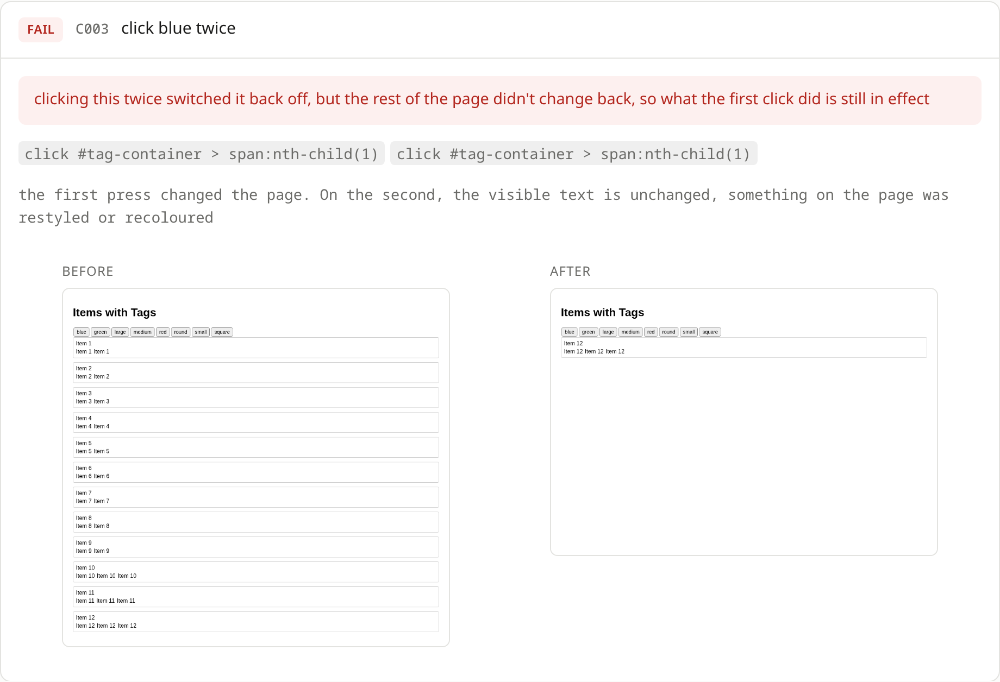

<!-- i18n-source: docs/usage.md 4fc8af90f6d6d12babc4d55ec7e9668ec62ae3d8 -->

<h1 align="center">Использование</h1>

<p align="center"><a href="../README.ru.md">assay</a> › Использование</p>

<p align="center"><a href="usage.md">English</a> · <a href="usage.zh-CN.md">简体中文</a> · <a href="usage.ja.md">日本語</a> · <a href="usage.ko.md">한국어</a> · <b>Русский</b></p>

<p align="center">Все параметры команды assay, её вывод, коды завершения, HTML-отчёт и Python API.</p>

---

## <a id="contents"></a>Содержание

- [Команда](#the-command)
- [Параметры](#options)
- [Что выводит assay](#what-assay-prints)
  - [Вывод по умолчанию](#the-default-output)
  - [Короткая сводка](#the-short-summary)
  - [JSON](#json)
  - [Элементы управления](#the-controls)
- [Коды завершения](#exit-codes)
- [HTML-отчёт](#the-html-report)
- [Цвет](#colour)
- [Ошибки](#errors)
- [Использование из Python](#from-python)
  - [Проверка страницы](#checking-a-page)
  - [Критерии приёмки](#acceptance-criteria)
  - [Список элементов управления](#listing-the-controls)

---

## <a id="the-command"></a>Команда

```console
assay ./my-app                    # проверить index.html в этой папке
assay ./my-app/todo.html          # проверить конкретную страницу
assay ./my-app -e app.html        # или указать страницу внутри папки

assay ./my-app --report out.html  # также записать HTML-отчёт со скриншотами
assay ./my-app --json             # вывести весь запуск в формате JSON
assay ./my-app --one-line         # краткая сводка для скриптов и агентов
assay ./my-app --surface          # перечислить найденные элементы управления и завершиться
```

assay принимает один путь. Если путь указывает на папку, assay раздаёт эту папку и открывает в ней `index.html`. Если путь заканчивается на `.html`, `.htm` или `.xhtml`, этот файл и есть проверяемая страница, а assay раздаёт папку, в которой он лежит, потому что страница загружает соседние файлы.

Если что-то не прошло, код завершения будет ненулевым. Помимо скачивания Chromium при первом запуске, assay ничего не записывает на диск, пока вы сами об этом не попросите.

---

## <a id="options"></a>Параметры

| Параметр | Что он делает |
|---|---|
| `-e ENTRY`, `--entry ENTRY` | Открывает в папке `ENTRY` вместо `index.html` |
| `--report FILE` | Дополнительно записывает HTML-отчёт (report) в `FILE` со скриншотами страницы до и после каждой проверки |
| `--json` | Выводит весь запуск в формате JSON вместо вывода по умолчанию |
| `--one-line` | Выводит короткую сводку о том, что проверено и что помечено как проблемное (flagged) |
| `--if-page` | Ничего не выводит и завершается с кодом 0, если путь не указывает на страницу, которую assay может проверить |
| `--surface` | Выводит элементы управления (control), которые есть на странице, и останавливается, не запуская проверки (check) |
| `--version` | Выводит установленную версию и завершается |
| `-h`, `--help` | Выводит описание параметров и завершается |

`--if-page` нужен хукам (hook), которые запускаются после каждой правки. Большинство правок не касается страницы, и с этим параметром assay в таких случаях молчит и не выводит ошибку в разговор с агентом.

Если заданы и `--json`, и `--one-line`, assay выводит JSON.

---

## <a id="what-assay-prints"></a>Что выводит assay

### <a id="the-default-output"></a>Вывод по умолчанию

```console
$ assay benchmarks/generated/programs/dsh/gpt-oss-120b/37_draw2
24 cases planned, 24 carried out, 23 passed, 1 failed

C015 [ok] draw on canvas, then draw somewhere else on it
C016 [FAILED] draw on canvas twice, then press Undo twice
    → when pressed twice from the same starting point, this changed nothing on the first press and changed the page on the second, so it reacts one press late
C017 [ok] draw on canvas twice, then press Redo twice
```

Первая строка показывает, сколько проверок запланировано, выполнено, пройдено и не пройдено. Затем идут все проверки в порядке запуска, каждая с номером, результатом и описанием того, что она сделала.

| Результат | Что он значит |
|---|---|
| `[ok]` | Проверка выполнена, и всё в порядке |
| `[FAILED]` | Нарушено правило (rule), и строка, начинающаяся с `→`, объясняет, что произошло |
| `[not checked]` | Проверку не удалось выполнить, и это никогда не считается провалом |

Провал, повторяющий более раннее замечание (finding), показывает `↳ same finding as C003` (то же замечание, что и C003) вместо сообщения, а первая строка сообщает, сколько провалов являются повторами.

Проверки нумеруются `C001`, `C002` и так далее. Замечания обо всём запуске, которые не могла бы показать ни одна отдельная проверка, нумеруются `F001`, `F002`, а два замечания обо всей странице имеют номер `C000`.

---

### <a id="the-short-summary"></a>Короткая сводка

Если ничего не помечено, `--one-line` выводит одно предложение.

```
assay: checked todo/todo.html, 8 checks, nothing flagged.
```

Если что-то помечено, он выводит по одной строке на каждое замечание, а повтор называет первое замечание и не повторяет его сообщение.

```
assay: checked notes/index.html, 12 checks, 4 flagged:
  - press Clear all: the page threw an error and stopped running, Cannot set properties of null (setting 'innerHTML')
  - press Clear all twice (same finding as press Clear all)
  - press Add, then Clear all (same finding as press Clear all)
  - press Clear all, then Add (same finding as press Clear all)
```

Если часть проверок не удалось выполнить, первая строка сообщает, сколько их, поэтому страница не считается чистой из-за проверок, которые так и не запустились. Текст, взятый со страницы, сводится к одной строке печатных символов, поэтому страница не может добавить в сводку собственную строку.

---

### <a id="json"></a>JSON

`--json` выводит один объект со следующими полями.

| Поле | Что в нём |
|---|---|
| `version` | Версия assay |
| `entry` | Открытая страница |
| `planned`, `passed`, `failed` | Сколько проверок запланировано, пройдено и не пройдено |
| `works` | `true`, если ни одна проверка не провалена |
| `sandboxed` | `true`, если страница работала в песочнице Chromium |
| `surface` | Все найденные элементы управления, у каждого `kind`, `selector`, `label` и признак `enabled` |
| `cases` | Все проверки, они описаны ниже |
| `links` | Все связи между замечаниями в виде `from`, `kind`, `to` и `why` |
| `console_errors` | Ошибки, которые страница записала в консоль |
| `failed_requests` | Запросы страницы, которые завершились неудачей |

У каждого элемента `cases` следующие поля.

| Поле | Что в нём |
|---|---|
| `id` | Номер проверки, например `C003` |
| `what` | Что сделала проверка, словами |
| `outcome` | `passed`, `failed` или `unknown`, где `unknown` означает, что проверка не выполнена |
| `detail` | Что пошло не так, для проваленной проверки |
| `measured` | Что измерил assay, независимо от результата проверки |
| `acts` | Действия, которые проверка выполнила, по порядку |
| `rules` | Названия правил, которые нарушила проверка |
| `key` | Имя замечания, которое не меняется при добавлении проверок, в виде `rule@what the check did` |
| `links` | Связи этого замечания с другим в виде `kind`, `to` и `why` |

Ошибки в консоли и неудачные запросы никогда не проваливают проверку, потому что страница может записать ошибку или не загрузить значок и всё равно работать. Но когда проверка действительно провалена, их часто стоит прочитать в первую очередь.

---

### <a id="the-controls"></a>Элементы управления

`--surface` перечисляет то, что assay нашёл на странице, по одному элементу управления в строке, с его видом, селектором, меткой и размером в пикселях.

```console
$ assay benchmarks/generated/programs/dsh/gpt-oss-120b/01_counter --surface
kind: page
- button `#inc` 'Increment' 151x52
- button `#reset` 'Reset' 107x52
```

---

## <a id="exit-codes"></a>Коды завершения

| Код | Когда |
|---|---|
| 0 | Ни одна проверка не провалена |
| 1 | Провалена хотя бы одна проверка |
| 2 | Страницу не удалось проверить, потому что её нет, ей нужна сборка или не удалось установить Chromium |

С параметром `--if-page` assay завершается с кодом 0 вместо 2. `--surface` завершается с кодом 0, как только перечислит элементы управления.

---

## <a id="the-html-report"></a>HTML-отчёт

`--report` записывает страницу, которую можно открыть в браузере. На ней для каждой проверки показано, как страница выглядела до и после.



Для каждой проверки отчёт показывает её действия, результат и причину, а также то, что измерил assay. Отчёт состоит из одного HTML-файла, а скриншоты лежат рядом с ним в папке, названной по имени отчёта, поэтому `--report out.html` записывает ещё и `out-shots/`. Отчёт ничего не загружает из интернета, поэтому открывается прямо с диска или из артефакта CI, и он следует вашей светлой или тёмной теме.

---

## <a id="colour"></a>Цвет

В терминале assay раскрашивает результаты, чтобы провалы были заметнее. Вывод, направленный в канал или файл, остаётся без цвета. Переменная окружения `NO_COLOR` отключает цвет, а `FORCE_COLOR` включает его везде.

---

## <a id="errors"></a>Ошибки

assay выводит эти сообщения в поток ошибок.

| Сообщение | Что оно значит |
|---|---|
| `assay: my-app/index.html doesn't exist` | По этому пути нет страницы, которую можно открыть |
| `assay: index.html loads /src/main.jsx, which a browser can't run without a build step.` | Папка является деревом исходного кода. assay выводит команду сборки, которую нужно запустить самостоятельно, и никогда не запускает её сам |
| `assay: index.html loads /src/main.jsx, which a browser can't run, but dist/index.html is built.` | В папке есть собранная копия, и assay выводит путь, который нужно проверить вместо неё |
| `assay: there's no index.html here, but there's a package.json, so the page probably comes from a build step.` | Папка является проектом, который ещё не собран |
| `assay: Chromium isn't installed yet, so assay is downloading it. This only happens once.` | Первый запуск скачивает Chromium |
| `assay: playwright isn't installed. Run pip install assay-ui to install it.` | В этом Python нет зависимости самого assay |
| `assay: Chromium's sandbox couldn't start on this system, so the page ran without it.` | Страница всё равно проверена. Песочница не запускается при работе от имени root и в некоторых контейнерах |

Если отдельную проверку не удалось выполнить, запуск продолжается, а эта проверка отмечается как не проверенная (not checked) с указанием причины, например когда страница подменяет встроенную функцию, на которую опирается assay.

---

## <a id="from-python"></a>Использование из Python

### <a id="checking-a-page"></a>Проверка страницы

```python
from assay import check

report = check("./my-app")
for result in report.failing:
    print(result.case.what, "->", result.detail)
```

`check` принимает следующие аргументы.

| Аргумент | Что он делает |
|---|---|
| `folder` | Папка со страницей или сама страница. Путь читается так же, как его читает команда |
| `entry` | Страница, которую нужно открыть в папке. По умолчанию это `index.html` |
| `criteria` | Ваши собственные проверки, которые запускаются раньше проверок assay. Они описаны ниже |
| `shots` | Папка для скриншотов до и после каждой проверки. Без неё на диск ничего не записывается |

Он возвращает отчёт со следующими атрибутами.

| Атрибут | Что в нём |
|---|---|
| `works` | `True`, если ни одна проверка не провалена |
| `plan` | Все проверки в порядке запуска |
| `results` | Результат каждой проверки по её номеру |
| `failing` | Проваленные результаты, сначала ваши собственные критерии |
| `unchecked` | Результаты проверок, которые не удалось выполнить |
| `surface` | Элементы управления, которые нашёл assay |
| `console_errors`, `failed_requests` | То, что страница записала в консоль, и неудачные запросы |
| `summary()`, `render()` | Первая строка вывода и весь вывод в виде текста |

У каждого результата есть `case`, который он выполнял, `outcome` со значением `"passed"`, `"failed"` или `"unknown"`, `detail` с описанием того, что пошло не так, `evidence` с тем, что измерил assay, нарушенные `rules` и его `key`.

---

### <a id="acceptance-criteria"></a>Критерии приёмки

assay не знает, что должен делать элемент управления, поэтому страница, которая работает, но делает не то, обычно проходит проверку. Чтобы проверить, что страница должна делать, напишите собственную проверку и передайте её как критерий приёмки (acceptance criteria).

```python
from assay import Case, check

total = Case(
    id="A001",
    what="adding 10 and 20 shows a total of 30",
    acts=[{"fill": "#price=10"}, {"click": "#add"},
          {"fill": "#price=20"}, {"click": "#add"}],
    expect={"want": "Total: 30"},
    origin="criterion",
)

report = check("./my-app", criteria=[total])
```

На странице, которая неверно считает сумму, этот критерий проваливается со следующим описанием.

```
the page doesn't contain 'Total: 30'
```

`acts` содержит действия, которые нужно выполнить по порядку. Каждое состоит из глагола и его цели.

| Действие | Что оно делает |
|---|---|
| `{"click": "#add"}` | Нажимает элемент, которому соответствует селектор. Подходит и надпись на элементе управления, например `{"click": "Add"}` |
| `{"fill": "#price=10"}` | Вводит значение после `=` в поле ввода, которому соответствует селектор |
| `{"press": "Enter"}` | Нажимает клавишу |
| `{"reload": "page"}` | Перезагружает страницу |
| `{"wait": "2"}` | Ждёт указанное число секунд, не больше 10 |

`expect` говорит, что должно быть верно после этого.

| Ожидание | Что должно быть верно |
|---|---|
| `{"want": "Total: 30"}` | Текст появляется на странице |
| `{"unchanged": True}` | Страница остаётся прежней |
| `{"quiet": True}` | Ничего определённого, поэтому проверка проваливается, только если страница выбрасывает ошибку |
| `{}` | На странице что-то меняется |

assay сам нумерует каждую проверку, поэтому `id` критерия в результатах заменяется. `--json` выводит `acts` каждой проверки, которую планирует assay, и по ним видно, как assay записывает каждый вид действия.

---

### <a id="listing-the-controls"></a>Список элементов управления

`look` открывает страницу и перечисляет её элементы управления, не запуская проверки, так же как `--surface`.

```python
from assay import look

opened = look("./my-app")
print(opened.surface.render())
```

---

Эта страница является переводом [usage.md](usage.md). Если перевод расходится с английским оригиналом, верным считается оригинал. Если вы нашли ошибку в переводе, пришлите исправление через пулреквест.
